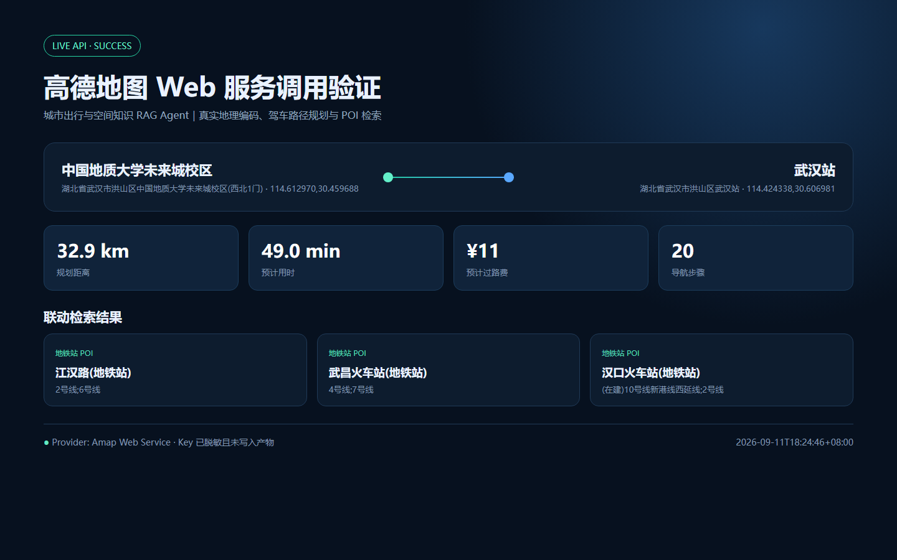

# 城市出行与空间知识 RAG Agent

面向城市交通、导航与空间数据场景的可追溯 RAG 项目。项目覆盖文档解析、元数据治理、分块、向量化、增量索引、BM25 与向量混合召回、重排序、引用回答、LangGraph 场景路由、高德地图 MCP 工具以及离线评测。

## Why this project

普通导航助手擅长调用实时工具，但难以回答施工规范、骑行安全、交通政策和空间数据治理问题；普通知识库又缺少 POI、地址和路径规划能力。本项目把“可引用的知识回答”和“实时地图工具”拆分为两条可观测链路，再由场景路由统一编排。

## Features

- 多格式解析：Markdown、TXT、JSON、JSONL、CSV、PDF 和 DOCX；二进制文档支持 sidecar 元数据治理
- 元数据治理：稳定文档 ID、来源、更新时间、分类和 SHA-256 版本指纹
- 增量索引：跳过未变化文档，更新变更文档并清理已删除文档
- 混合检索：BM25 + dense vector + reciprocal-rank fusion
- 透明重排序：查询覆盖度、标题匹配和检索得分融合
- 引用回答：答案、证据片段、文档来源和执行 trace 同时返回
- LangGraph 路由：知识、路线、POI、天气场景条件分支
- 高德 MCP：地理编码、POI 搜索、驾车路线规划
- 评测闭环：Recall@8、MRR@8、路由准确率、引用准确率、P50/P95 延迟
- 真实本地 Embedding：默认使用由 BGE-M3 蒸馏的多语言 Model2Vec 模型；Hash Embedding 仅用于单元测试

## Quick start

```powershell
cd "urban-mobility-rag-agent"
python -m venv .venv
.\.venv\Scripts\Activate.ps1
python -m pip install ".[documents,embeddings]" --no-cache-dir
python scripts\ingest.py
python scripts\quality_report.py
python scripts\demo.py "道路施工信息如何增量更新？"
python scripts\evaluate.py
```

启动网页服务：

```powershell
python -m pip install ".[api]" --no-cache-dir
python -m uvicorn app:app --reload
```

浏览器打开 `http://127.0.0.1:8000`。

## Optional production integrations

复制 `.env.example` 为 `.env`，按需配置：

- `LLM_BASE_URL`、`LLM_API_KEY`：OpenAI-compatible Embedding 与 Chat API
- `AMAP_API_KEY`：高德 Web 服务 Key
- `MILVUS_URI`：Milvus Standalone 或云服务地址

运行高德 MCP 服务：

```powershell
python -m pip install -e ".[agent]"
python scripts\amap_mcp_server.py
```

真实 Milvus 的本地启动、配置和验证见 [Milvus setup](docs/milvus_setup.md)。首次发布到 GitHub 前，请按 [GitHub publish checklist](docs/github_publish.md) 核对作者信息、密钥和提交历史。

## Repository map

```text
src/urban_mobility_rag/
  loaders.py       document parsing and metadata
  chunking.py      metadata-aware chunking
  embeddings.py    offline and API embeddings
  store.py         local and Milvus vector stores
  bm25.py          sparse retrieval
  retrieval.py     hybrid retrieval and reranking
  pipeline.py      cited RAG pipeline and traces
  graph.py         LangGraph scenario routing
  amap.py          Amap client and MCP tools
  api.py           FastAPI service
data/              demo corpus and evaluation set
docs/              architecture, governance and product story
tests/             deterministic unit tests
```

## Verified baseline

当前基线使用 7 篇演示文档（含 Markdown、DOCX、PDF）和 68 条评测问题，其中包含 12 条困难负样本。默认 Embedding 为真实的 `minishlab/potion-multilingual-128M` 256 维模型，Hash Embedding 仅保留给确定性单元测试。最新结果见 [benchmark report](docs/benchmark_report.md)。评测数字只说明演示数据上的链路表现，不代表真实城市业务数据上的生产效果。

Milvus 3.0.1 已在 Windows Docker Desktop 环境完成真实入库、检索及增量更新验证，证据保存在 `artifacts/milvus_verification.json`。高德 Web 服务已完成真实地理编码、驾车路线规划与 POI 检索，脱敏证据保存在 `artifacts/amap_demo.json` 和 `artifacts/amap_demo.png`。各集成项的当前验证状态见 [implementation status](docs/implementation_status.md)。

## Live Amap demo

以下结果由高德 Web 服务真实调用生成，覆盖地理编码、驾车路线规划和 POI 检索。截图与 JSON 均不包含 API Key。



## Data notice

The bundled corpus is synthetic demonstration content written for this repository. It is not a substitute for official traffic notices or real-time navigation. Do not commit private location histories, internal company documents or API keys.

## Author

Aris Xu — acexbr@outlook.com
