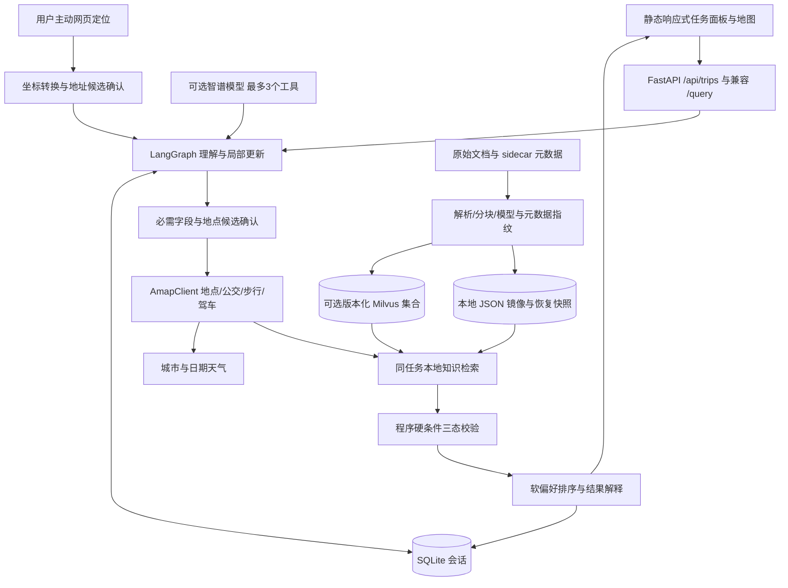

# PathCue 当前架构

图的澄清与失败节点直接结束，不存在自主规划循环。地图使用现有 AmapClient 直接接入有限任务，原 MCP 工具入口继续保留给脚本使用；网页无需通过 MCP 转发。

模型每轮只做一次有界工具选择，输出经过参数与工具名单校验，调用已有路线、知识与天气能力。拒绝执行 shell、任意网络请求或自动确认位置。网页定位由用户点击触发，不由模型请求设备权限；原始 GPS 和定位地址不进入模型上下文。未将 ContextPilot 的模拟执行层合并进来。

检索顺序：乘客/维护者与真实/演示隔离、地域和时间过滤 → BM25 + 向量 → RRF → 原启发式重排序 → 证据门槛 → 支撑具体陈述的抽取句与引用。多版本同范围资料提示可能冲突，不声称能自动判断所有语义矛盾。

请求只提交本轮修改。服务端状态是唯一已确认需求；表单未提交输入只是草稿，立即使旧方案失效。选中路线与地图高亮共用一个 selected id，切换选中项不重新 fit bounds。

详见 [升级指南与API](upgrade.md)、[实际验证结果](validation.md)。
