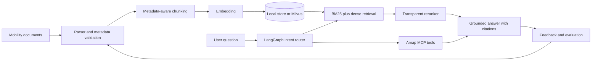

# Architecture

## End-to-end flow

## Engineering decisions

- **Offline-first:** deterministic hash embeddings and a JSON vector store make CI reproducible without keys.
- **Production adapter:** `MilvusVectorStore` supports a real vector database when configured.
- **Hybrid retrieval:** reciprocal-rank fusion combines dense semantic retrieval with BM25 keyword retrieval.
- **Traceability:** every chunk carries `doc_id`, source, checksum, chunk index and update metadata.
- **Incremental indexing:** unchanged document checksums are skipped; changed and removed documents are reconciled.
- **Observable workflow:** query results expose route, candidate count, selected chunk IDs, confidence and latency.
- **Tool isolation:** map operations are exposed through a dedicated MCP server instead of being embedded in prompts.

## Production extensions

1. Replace hash embeddings with a hosted or local Chinese embedding model.
2. Use Milvus dense plus sparse fields and server-side BM25 hybrid search.
3. Add a cross-encoder reranker and offline relevance labels.
4. Parse document layout, tables and OCR results into typed metadata.
5. Add temporal and geographic filters before retrieval.
6. Add authentication, rate limits, object storage and tracing.

