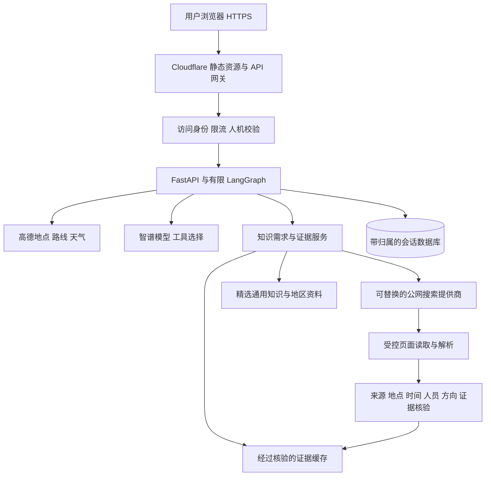

# PathCue 公网版改造方案

方案日期：2026-10-16。TinyFish Search/Fetch 与 Cloudflare Web Search 适配器、受控页面读取、候选证据缓存、签名访客身份、会话归属检查和单实例按 IP 限流已进入代码。TinyFish 已完成固定数据测试和本地真实凭证调用。Cloudflare Quick Tunnel 公网预览已发布并完成 HTTP 健康检查；它仍依赖本机持续运行，尚未完成不依赖本机的长期云端部署、全站预算和外部实体设备验收。

产品名：**PathCue｜情境感知与知识增强的出行助手**。

页面说明：**结合你的位置、天气和出行要求，找到合适的路线。**

## 1. 产品闭环

普通出行请求通过地图和天气工具获得候选；涉及校门、夜间通行、站口、设施时，识别影响方案成立的知识条件，按需寻找证据。无需先为每个城市人工维护完整知识库。

当天气接口在用户出发时段返回雨、雪、雾霾或沙尘等不良天气时，候选仍先检查预算、步行上限、换乘上限等硬条件；通过硬条件后自动优先少步行、少换乘，再应用用户选择的耗时或费用偏好。城市级日夜预报不是逐小时保证，过期或失败资料不参与排序。

例如“北京大学晚上十二点从东门去北京站”：先确认午夜日期、具体东门及用户是否需要从校内出校，再核对适用于该校门、出校方向、时间与人员身份的规则。入校预约政策不能推导出校限制。没有可靠证据时，明确“该方案以东门可出校为前提，尚待确认”；如果用户已经在门外，则不应无谓核查出校政策。

## 2. 推荐部署边界

首版推荐 **Cloudflare 公网入口 + 现有 FastAPI 容器后端**。前端静态资源和同源 API 网关由 Worker 提供；FastAPI 运行在有持久存储的云主机或容器服务，保留现有 Python、LangGraph、BM25、向量与 RRF。公网版不依赖开发电脑一直开机。



Cloudflare 已支持 Python Workers 上的 FastAPI，但现有项目的原生 embedding 依赖、本地 SQLite、文件索引和同步网络调用不应未经验证原样迁入。若要求后端也全部在 Cloudflare，可使用 Cloudflare Containers 保留 Python 运行环境，同时将持久状态外置；Containers 需要 Workers 付费计划。另一条路线是全面适配 Workers、D1 和存储绑定，改造范围更大，不作为必要的第一步。

Cloudflare Tunnel 提供通往源站的连接，不替代应用服务器或数据库。可用于受控演示或连接长期运行的源站；临时开发机隧道不作为持续可用的公网部署。

## 3. 联网检索与 RAG 的职责

增加 `EvidenceService`，统一调用 `KnowledgeStore`、`SearchProvider`、`PageReader`、`EvidenceCache`。

1. Agent 提取 `knowledge_needs`：主体、设施、问题、日期时段、方向、适用人员、是否影响路线可行性。
2. 先查精选知识与未过期的证据缓存，按地域、设施和适用时间过滤。
3. 存在关键缺口时，联网搜索相关机构、运营方或政府发布的原始资料；无需将所有城市写入静态库。
4. 读取相关正文或 PDF。搜索摘要只用于发现来源，不直接充当通行事实依据。
5. 分块并保留 URL、标题、发布时间、获取时间、有效期、版本与具体证据段；沿用 BM25、向量、RRF 和重排序筛选。
6. 模型辅助抽取具体规则，程序校验字段、数值、时间和引用段是否存在；来源不适用、过期、冲突或缺失时返回明确状态。
7. 临时缓存核验结果；不把整张网页或一次性用户查询自动写成长期可信知识。精选库的增加、更新、删除走独立入库流程。

不同城市都可以搜索；“公开网络上存在资料”仍不等于“资料完整且能核实当前状态”。公开规则与实时开放状态分别记录，刚抓到旧公告不能等同于获得实时状态。

默认联网后端使用 TinyFish：Search 只负责返回标题、摘要和 URL，Fetch 负责取得可引用的页面正文。两者共用服务端 API Key；根据 2026-10-16 的官方价格页，Search 和 Fetch 在公开限额内免费。公开部署仍需缓存、访客限流和总量保护，不能把第三方免费额度视为无限资源。

Cloudflare Web Search 保留为可选后端。它经 AI Gateway 调用搜索提供商，使用时仍需独立核对权限、额度和计费。供应商选择由 `ONLINE_SEARCH_BACKEND` 隔离，不进入业务状态契约。

## 4. Agent 调整

现有每轮一次模型选择足以做简单分流，联网搜索需要支持“搜索后读取，再根据证据决定结果”的有界流程：

```text
理解与更新 → 澄清和地点确认 → 获取路线与天气
 → 识别关键知识缺口 → 查库/缓存
 → 必要时搜索并读取 → 核验证据 → 校验条件 → 比较与解释
```

建议初始预算：每任务最多2次搜索、读取3个页面、模型交互最多3轮，总时限和 token 上限可配置。达到上限就返回部分结果与待确认项，不无限循环。网页正文作为不可信数据，不得修改工具白名单、权限、预算或系统指令。

输出增加 `knowledge_needs`、`evidence_status` 和 `assumptions`，区分规则有依据、资料冲突、已过期、未找到与实时状态未知。未核实的关键前提不能被折算成“满足所有条件”。

## 5. 多用户改造

当前 SQLite 会话只按 session_id 读写，尚无归属校验；请求还共用全局锁及地图客户端的调用预算。这些都是公网前必须修复的真实代码问题。

- 建立访客或登录身份，通过 Secure、HttpOnly、SameSite Cookie 关联会话；session_id 只是标识符，不能独自决定访问权限。
- 所有读取、更新、地图图片、定位 token、删除与任务接口都检查归属；其他访客即使取得 UUID 也无权读取。
- 会话锁改为按会话或行程隔离；地图客户端和调用预算按请求隔离，避免不同用户相互重置调用次数或长期排队。
- 更新带 revision，原子检查与保存，处理同一用户多标签页的并发修改。
- 小规模单实例可暂用带持久卷的 SQLite 和备份；扩展多副本时迁移到共享事务数据库，不直接复制本地数据库文件。
- 精确位置不放到共享知识缓存或模型提示里，提供清除行程与数据到期删除。日志避免记录完整坐标、凭证与私密对话。

## 6. 公网入口与成本

前后端使用同一域名下的 `/api`，保护源站仅接受可信网关请求，服务端凭证使用部署平台的 Secrets。浏览器地图 Key 继续单独配置允许域名。

在发起付费调用前执行配额检查：访客额度、IP 辅助限流、全站每日预算、同时执行任务数、单任务搜索和模型上限。Turnstile 令牌由服务端验证，不能只显示前端组件；人机校验也不替代身份与限流。额度不足时保留已有结果，明确停止新调用，不自动切换收费模型。

对页面读取限制 HTTPS、公开地址、重定向次数、响应大小、类型与超时，阻止访问内网、localhost、云元数据端点和重定向后的受限地址。第三方网页不能触发代码执行或凭证发送。

长期部署所需的自定义域名、常开源站位置和可接受的调用预算尚未确定。当前仅发布带签名访客会话、安全响应头及每 IP 限流的 Quick Tunnel 预览，没有创建付费 Cloudflare 资源。

## 7. 页面变化

继续保留两栏任务面板与地图。方案附近按需显示“需要确认的通行条件”和“已找到的出行资料”；来源展示发布与核验时间、适用人员、时段、进出方向及证据段。

加载只显示真实步骤，例如“查询路线”“查找校门通行资料”“核对资料适用时间”。搜索失败时地图方案仍可查看，带关键未知条件的方案必须显式标注前提，不显示为完全符合要求。

## 8. 实施顺序与验收

| 阶段 | 工作与完成标准 |
| --- | --- |
| A 联网证据闭环 | 搜索、页面读取、引用段与适用性核验；北大午夜东门案例不得猜测开放时间 |
| B 多用户与预算 | 归属、并发、revision、请求独立预算、访客额度与全站熔断；用户A无法读取用户B的行程或地图 |
| C 云端预发布 | 配置模板、容器构建、持久卷、健康检查、HTTPS、源站保护；不依赖本机，重启后会话恢复 |
| D 公网验收 | 在另一台设备检查定位授权/拒绝、真实路线、天气、跨城市搜索、失败和额度状态；通过后再开放访问 |

补充用例：校门入校/出校混淆，学生/访客范围差异，跨午夜日期，找不到官方资料，旧公告与新公告冲突，搜索超时，恶意网页指令，内网 URL 与重定向拦截，多用户并发、删除与恢复。离线固定数据测试、真实供应商验证与公网体验分别记录。

## 官方资料

- [Workers 静态资源](https://developers.cloudflare.com/workers/static-assets/)
- [Python Workers 的 FastAPI 支持](https://developers.cloudflare.com/workers/languages/python/packages/fastapi/)
- [Python Workers 包兼容边界](https://developers.cloudflare.com/workers/languages/python/packages/)
- [Cloudflare Containers 与付费计划](https://developers.cloudflare.com/containers/)
- [Cloudflare Tunnel 的服务器前提](https://developers.cloudflare.com/tunnel/get-started/)
- [TinyFish Search/Fetch](https://www.tinyfish.ai/free-search-fetch)
- [TinyFish 价格与免费限额](https://www.tinyfish.ai/pricing)
- [Web Search API 的测试状态、REST 和计费](https://developers.cloudflare.com/web-search/)
- [Web Search API 用法](https://developers.cloudflare.com/web-search/how-to-use/)
- [Turnstile 服务端验证](https://developers.cloudflare.com/turnstile/get-started/server-side-validation/)
