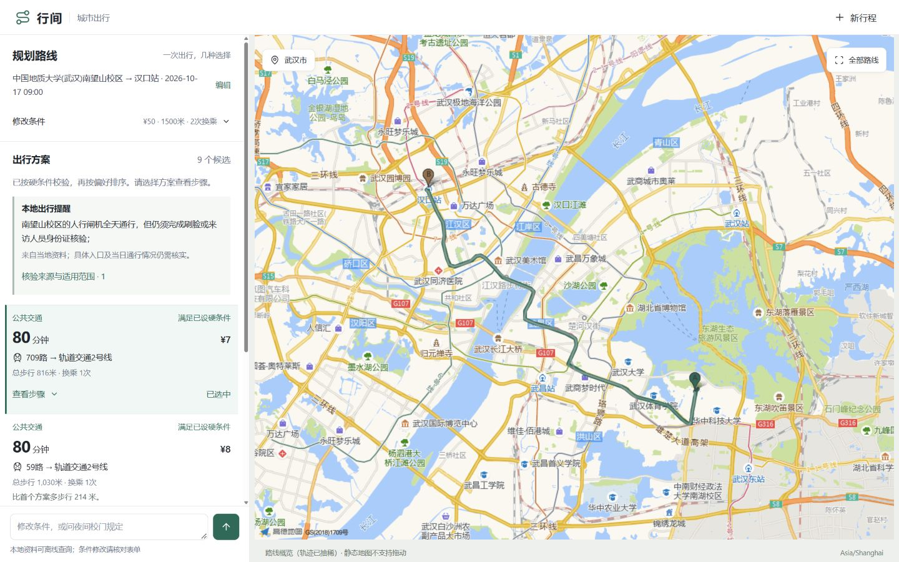

# 验收记录（2026-10-16）

本次结论来自运行的代码和实际浏览器检查。旧 evaluation_report / benchmark / 2026-09 的接口截图均未作为新链路已经验收的证据。

## 离线固定数据

```powershell
.\.venv\Scripts\python -m pytest -q
.\.venv\Scripts\ruff check --isolated --select F,I src tests scripts/qa_server.py
node --check static/app.js
```

最终运行：**71 passed**。检查项包括：

- 同名 POI 不自动选择；确认后地图工具真实分支才执行，知识检索同任务执行。
- “预算从30提高到50，其他不变”保留地点、步行与已确认位置。
- null 取消限制、0 为零上限、自然语言新行程隔离、旧 trip_id 拒绝。
- 无解不自动放宽；未知费用不是零，通行费不是打车价，预计赶得上截止时间仍无法保证。
- 工具失败/超时、空路线、非法条件、会话持久化恢复、旧结果失效。
- 地域、有效日期、乘客/维护者、真实/演示过滤；具体引用句是对应 chunk 原文。
- sidecar、模型名、模型版本变更触发重建，本地快照可恢复。
- Milvus metadata 往返、服务端过滤参数、旧 schema 不删除原集合（使用 mock，不是实连）。
- 高德空 taxi/railway 对象不会误判真实混合路段。
- 静态地图选中项变更后视野保持一致，重复请求命中缓存，服务端 Key 不在公开配置。
- 无法确认的无障碍要求持续保留，后续预算修改不丢弃；明确取消后才恢复规划。
- 新鲜天气资料在出发时段出现雨、雪、雾霾或沙尘时，先在满足硬条件的方案中按少步行、少换乘排序，再应用用户的其他软偏好；过期或查询失败的天气不改变排序。
- 多个同范围资料版本提示可能冲突；这不是通用语义矛盾检测器。
- 全国步行、骑行、巡游出租车、铁路和地铁主题按上下文过滤，不把一个主题的资料串到另一个主题。
- 联网搜索摘要不直接成为引用；只有从受控 HTTPS 页面读取到的原文可成为候选证据。内网地址、非 HTTPS、超大页面和不支持类型被拒绝。
- 公网模式使用签名 HttpOnly 访客 Cookie 绑定会话；另一访客及篡改 Cookie 均无法读取相同 session_id。
- 公网写接口启用单实例按 IP 滑动窗口限流，并返回安全响应头；超过额度时返回 429 和 Retry-After。

## 公网预览

2026-10-16 使用 Cloudflare Quick Tunnel 将本机 FastAPI 暂时发布为 HTTPS 公网预览。已从公网入口验证主页返回 200、`/health` 为 ok 且索引 23 条资料，公开配置显示自然语言、联网证据和地图均已启用。随机预览 URL 不写入版本库，因为隧道重启后可能变化；本次交付时的有效地址在交付消息中提供。

该预览依赖本机 Uvicorn 和 cloudflared 进程持续运行，不作为不依赖本机的长期生产部署。长期发布仍需常开源站或 Cloudflare Containers 等容器环境，并把 SQLite/索引放到持久存储。

显式固定数据服务：

```powershell
$env:QA_FIXTURE_MODE='1'
.\.venv\Scripts\python scripts/qa_server.py
```

测试服务监听 127.0.0.1:8765，使用独立 data/index-qa，顶栏明确显示“离线固定数据演示”；不调用真实高德。预算13是该测试服务专用超时场景。生产 app.py 不导入或注册 FakeAmap。

## 真实高德链路

复用了原本已配置的 Web 服务 Key，保存在未跟踪的本地 .env；没有提交或显示 Key。

先完成了未来城校区至汉口站验证；用户随后改为 **中国地质大学（南望山校区）→汉口站**，最终验收以南望山行程为准。未来城的9条候选快照保留为前一组验证，不混作最终路线数字。

- 高德地点确认：校区为“中国地质大学(武汉)南望山校区”，地址鲁磨路388号；终点为“汉口站”，地址发展大道185号，未误选同名地铁站、出站口或停车场。
- 样例日期：2026-10-17，09:00，Asia/Shanghai。不是对用户真实出行日期的推断。
- 初始预算30元，后改为50元；总步行1500米，最多换乘2次，允许公交/步行/驾车。
- 主流程返回 **5公交 + 3驾车 + 1步行 = 9候选**。公交、步行、驾车工具状态均为 ok。
- 排序首位公交方案预计约80分钟、费用7元、总步行816米、换乘1次。这是当次接口快照，不是时刻保证或固定票价承诺。
- 驾车保留不同候选；精确自驾总费用仍未知，但页面另列默认燃油车油费区间（百公里6–10升、非实时参考油价7.5元/升）与道路通行费。该区间不参加预算硬条件判定，也不冒充打车价格；电动车及具体车型需要用户补充后另算。
- 2026-10-16 晚间实调单驾车模式：南望山校区主 POI 至汉口站返回约26公里、40分钟、自驾约12–20元，按23:53出发显示预计次日00:33到达。
- 汉口站附近停车检索与步行接口实调成功：当次返回“武汉石油大厦停车场”，停车点至终点约19米、约1分钟。只表示高德附近 POI 与步行路径结果；车位、开放状态及收费仍需核实，且不纳入总步行硬限制。
- 地理编码兼容方法对校区官方地址实调成功。
- 高德静态地图已实调返回 PNG，由服务器代理，浏览器图片 URL 只有本地 session/route/尺寸参数，未包含 Key。
- 实际切换公交与驾车方案后，绿色高亮路线随选择改变；同尺寸保持共同视野，A/B 两端点均可见。
- 南望山校区官方人行闸机资料在同任务中被检索并展示来源；只作通行资料补充，不声称已匹配具体闸机坐标或实时设施状态。

结构化快照：[live_trip_verification.json](../artifacts/live_trip_verification.json)。快照中耗时会随交通情况变化；没有沿用仓库旧截图中的路线数字。

## 视觉与交互

实际启动 FastAPI，用浏览器操作表单、候选确认、方案切换、详情、来源、自然语言修改、Enter 提交、新行程、刷新恢复。不是只做编译检查。

| 尺寸 | 初始/加载/正常结果/详情/无解/失败 | 额外检查 |
| --- | --- | --- |
| 1440×900 | 固定数据六状态均截图检查 | 400px任务面板，地图与列表并置；真实高德公交地图截图 |
| 1280×800 | 固定数据六状态均截图检查 | 两栏，无默认第三列；真实驾车高亮截图 |
| 390×844 | 固定数据六状态均截图检查 | 上方地图、可展开底部方案面板；追问区不被遮挡；真实底图补验 |

DOM 尺寸检查无横向溢出，底部输入区位于可视区域。长驾车步骤在详情展示，列表只显示紧凑的路线摘要；条件确认后收起，保留可发现的条件摘要。切换选中项不刷新条件，不重新缩放同尺寸地图。

已检查移动面板的按钮展开、键盘 Enter 提交、表单标签和焦点样式。**未用实体手机验证软键盘与手势拖动**；代码处理 visualViewport、安全区和拖动后的点击抑制，但不将这些代码视为真机验证。

全部本地截图位于 artifacts/qa（不入库），包括桌面总览、真实驾车详情、RAG 来源展开和 390×844 移动端路线卡片；精选截图保存在 docs/validation-images，供评审查看。



## 未完成验证与边界

- 无 JS API Key：JS SDK 拖动/缩放及点击地图线选方案未实测。当前真实可用的是静态地图：支持列表选方案后更新高亮，不支持拖动/缩放及在图上点击线。轨迹为抽稀概览，详细计算用原始路线数值。
- 未配置 LLM Key：自然语言仅有限中文规则；不能声称任意自然语言、多约束语义都能准确理解。表单与知识检索仍可用。GLM 工具调用使用 mock 做了契约和失败回退测试，尚未用真实 Key 验证。
- TinyFish 真实接口验证：2026-10-16 使用服务端私有 Key 查询“武汉 临时交通管制 官方 公告”，Search 返回 5 个候选；Fetch 成功读取武汉市政府页面正文 2,072 字。随后通过 `/query` 端到端查询“武汉7月15日至16日哪些路段采取临时交通管制”，返回 `candidate_evidence` 和 3 条正文候选，首条来源为武汉市政府。页面仍提示核对地点、方向、人员与有效时间，没有把候选网页当作实时保证。
- TinyFish Search/Fetch 和 Cloudflare 兼容后端的请求契约、SSRF 防护、缓存及失败出口均有固定数据测试。API Key 只存在于本地 `.env`，未写入请求 URL、请求体、页面配置或仓库文件。
- 智谱 Key 加载后，`/api/config` 的 `natural_language` 与 `model_tools` 均为 `true`。页面应从 `http://127.0.0.1:8000/` 打开，不能直接打开 `static/index.html`。
- 跨午夜条件 `23:53 → 次日 02:53` 已通过固定数据测试。实际页面检查确认：未设置到达截止时仍显示按出发时间和地图耗时计算的预计到达时刻；未设置预算和步行上限时，页面仍展示自驾成本区间和停车后步行估算，但两项均不作为已满足硬条件的证明。
- 未连接 Milvus 服务：仅适配契约测试与迁移保护测试；不沿用旧版实连记录作为本次验证。
- 未重跑神经 embedding 模型。另以 hash 离线模式重跑68条旧评测（开发者检索基线，未模拟乘客过滤）：困难负样本拒答率0.6667，引用文档准确率0.8214，说明离线兜底仍有局限；不与旧神经模型结果直接比较，也不宣称质量提升。详见 artifacts/offline_hash_evaluation.json。
- RAG 本地提醒现位于方案上方，默认显示具体陈述，展开查看校方来源、适用区域及核验时间。知识追问沿用当前行程做检索上下文，并保留路线。
- 校区主 POI 和汉口站 POI 是确认地点，不等于已选定可通行校门、站内入口或进站安检路径；赶火车仍需额外预留进站时间。
- 当前共扫描23份资料，其中16份为真实乘客资料；全国基线覆盖步行、骑行、巡游出租车、铁路和地铁，城市/设施资料覆盖武汉样例与上海博物馆。它们不具备完整空间匹配，也不替代临时管制、积水、排队或设施实时状态。
- 公网模式已具备签名访客身份、会话归属检查、定位凭据归属和按会话锁；尚未完成 Turnstile、访客/IP/全站预算、跨多副本数据库及 Cloudflare 实际部署。SQLite 与 JSON/Milvus 的索引更新仍没有跨库事务。
